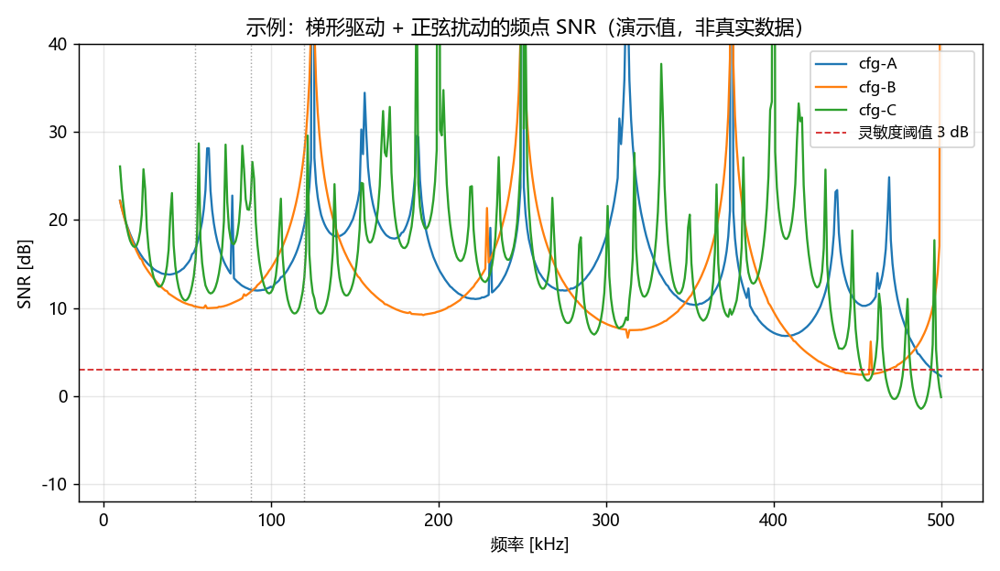

# Trapezoid-Wave SNR Sweep

> 通用方法框架：**梯形脉冲驱动信号在正弦扰动下的频点 SNR 解析建模**。
> 正向预测 SNR(f)、反向按目标频点搜索驱动参数（maximin），一套 numpy
> 向量化实现，几十行核心代码。

*English abstract: A closed-form, vectorized numpy model that predicts, for a
trapezoidal pulse-train excitation contaminated by a sinusoidal interferer,
the per-frequency SNR after block-averaged demodulation — then inverts it to
search drive parameters that keep target frequencies covered. Framework only:
no vendor parameters, no measured data, results up to a calibration gain.*

---

## 问题

很多模拟 / 传感前端用"分段梯形脉冲"激励负载并从返回信号中解调。当存在频率
为 `f` 的外部正弦干扰时，干扰会以确定性的采样/锁定关系混入解调结果，使部分
频点上 SNR 明显塌陷。

想知道某个驱动参数组合**能覆盖哪些频点、在哪些频点露馅**，最直接的办法是
解析建模而不是盲测。

## 方法

对单个激励段建模（`na` 个半周期 `ta` 的梯形脉冲、极性交替、段间静默 `td`），
把正弦干扰在每个脉冲窗口上的贡献解析积出，再按 **Block 平均**（每 `nb` 段
取一个 Block）得到信号 `μ(f)` 与 Block 间波动 `σ(f)`：

```
SNR_dB(f) = 10·log10( μ(f)·G / (σ(f)·f) )      # G = 链路标定增益，未标定取 1
```

曲线在"周期结构与干扰频率成整数/半整数关系"的频点处自然出现塌陷 →
低阈值以下即为**未覆盖频段**。反向把目标频点代入、在驱动参数网格上扫，即可做
覆盖寻优。

公式推导见 [`docs/model.md`](docs/model.md)。

## 快速开始

```bash
pip install numpy matplotlib
python demo.py
```

`demo.py` 会：

1. 用三组示例驱动配置扫频（10–500 kHz），打印低于阈值(3 dB)的未覆盖频段；
2. 对目标频点 `[55, 88, 120] kHz` 做极小规模 **maximin 寻参**；
3. 保存对比曲线到 `docs/demo_snr_curves.png`：



## 仓库结构

```
snr_model.py     核心：snr_for_freqs() 闭式向量化计算、sweep_snr() 扫频、
                 uncovered_spans() 未覆盖频段统计
demo.py          可运行演示：扫频对比 + maximin 寻参 + 出图
docs/model.md    完整公式推导与实现说明
```

## 边界声明

- 这是**纯方法框架**：仓库不含任何厂商芯片参数与实测数据，demo 中的数字
  均为演示用假设值；
- 绝对 SNR 量级依赖链路标定增益 `G`，本框架不假设其数值（dB 形状与
  相对比较不受影响）；
- 覆盖判定用最简单的低通门限，实际工程可按需换成带权目标函数。

## License

暂未选择许可证（默认法律含义为「保留所有权利」）。如需对外使用请先补充 LICENSE。
